# Device State Machine

This diagram reflects the current runtime behavior implemented in `internal/device/client.go`.

```mermaid
stateDiagram-v2
    [*] --> starting: Start()

    starting --> startup_cycle: actuator enabled
    starting --> detecting_ball: actuator disabled

    startup_cycle --> detecting_ball: startup extractor cycle OK
    startup_cycle --> error: startup extractor cycle failed

    detecting_ball --> ball_stuck_in_funnel: waitForBallReady failed
    ball_stuck_in_funnel --> detecting_ball: passive recovery successful
    ball_stuck_in_funnel --> ball_stuck_in_funnel: passive recovery failed

    detecting_ball --> ball_on_sensor: ball detected at sensor
    ball_on_sensor --> ball_detected: payment created
    detecting_ball --> error: payment create failed
    detecting_ball --> sold_out: payment create returned 409 sold_out
    sold_out --> detecting_ball: retry backoff elapsed

    ball_detected --> ball_detected: payment waiting/open/pending + phase=waiting_for_amount
    ball_detected --> awaiting_payment: payment waiting/open/pending + phase=waiting_for_payment

    awaiting_payment --> awaiting_payment: payment waiting/open/pending + phase=waiting_for_payment
    awaiting_payment --> ball_detected: payment waiting/open/pending + phase=waiting_for_amount

    ball_detected --> dispensing: payment success/paid/completed
    awaiting_payment --> dispensing: payment success/paid/completed
    awaiting_payment --> dispensing: enabled lever UP/DOWN (free ball)
    ball_detected --> dispensing: enabled lever UP/DOWN (free ball)

    ball_detected --> payment_failed: payment failure/failed/cancelled/expired/timeout
    awaiting_payment --> payment_failed: payment failure/failed/cancelled/expired/timeout

    payment_failed --> detecting_ball: payment reset

    dispensing --> detecting_ball: dispense + next-ball check OK
    dispensing --> awaiting_payment: free dispense + next-ball check OK; retain payment
    dispensing --> ball_detected: free dispense from QR screen + next-ball check OK; retain payment
    dispensing --> error: dispense failed

    state "Operator Command Scheduler" as cmd {
        [*] --> command_poll

        command_poll --> pending_command: command fetched but not executable now
        pending_command --> command_poll: next poll

        command_poll --> command_executing: executable command present
        command_executing --> command_poll: ack success/failed

        note right of pending_command
            Deferred while policy blocks execution.
            Examples:
            - load_test, ball_dispenser require clean state
            - home/extend/retract/vibrate blocked in waiting_for_payment
        end note
    }

    note right of command_executing
        Runtime state is set to command_executing
        while command runs and ack is sent.
    end note
```



## Command Policy Summary

- Always executable: `message`, `take_picture`, `cancel`
- Clean-state only: `load_test`, `ball_dispenser`
  - clean state means: no jam, no active payment, state is `detecting_ball` or `idle`
- Actuation commands: `home`, `extend`, `retract`, `vibrate`
  - allowed with active payment except when `payment_phase` is `waiting_for_payment`

## Data Signals Used

- Status endpoint: `GET /api/v1/payment/{id}`
- Transition signal for amount-selection phase split: `payment_phase`
  - `waiting_for_amount` keeps runtime in `ball_detected`
  - `waiting_for_payment` moves runtime to `awaiting_payment`

## Optional Free-Dispense Lever

The KN3C-223 lever is disabled by default. Enable it in `config.yaml`:

```yaml
LEVER_ENABLED: true
LEVER_UP_PIN: "GPIO26"
LEVER_DOWN_PIN: "GPIO21"
```

Wiring uses BCM GPIO numbering, not physical header numbering:

| Switch terminal | Raspberry Pi connection |
| --- | --- |
| Common | GND (for example physical pin 34) |
| UP | GPIO26 (physical pin 37) |
| DOWN | GPIO21 (physical pin 40) |

Both contacts are inputs with internal pull-ups; closing either contact to GND
is active-low. The HAT must leave these GPIOs available. No supply connection
is needed for the switch contacts.

- Both the QR/amount-selection state (`ball_detected`) and `awaiting_payment`
  accept lever movements. Startup, ball detection, dispensing, commands, errors,
  jams, and sold-out states ignore them.
- Inputs are sampled every 10 ms and debounced for 50 ms. One movement triggers
  one free dispense. Both contacts must stay neutral for 50 ms before re-arming,
  including after startup. Switching directions without a neutral interval
  counts as the same movement.
- A press made outside the eligible state is discarded, not deferred. Queued
  events also expire if the payment or runtime state changes before handling.
- Lever events wake the device loop without waiting for its normal API polling
  tick. Device work remains serialized: an in-progress API call or operation
  finishes before the event is handled, and actuator access remains locked.
- A free dispense uses the normal extractor, break-beam monitoring, and next-ball
  readiness checks. Failures surface through the existing error/jam states.
- After a successful free dispense, the machine returns to its previous payment
  state (`ball_detected` with QR visible, or `awaiting_payment`)
  with the **same pending payment ID and QR payload**. It does not create, cancel,
  replace, or mark that payment paid. If it later succeeds, it dispenses the next
  ball normally; expiry/failure still follows the normal payment reset flow.
- The free ball does not count as the retained payment's dispense and does not
  print a payment receipt. This prevents it from suppressing the later paid
  dispense or falsely attributing the free ball to a payment.
- GPIO initialization/read failures are logged and disable lever handling for
  that process; ordinary payment operation remains available. Restart the
  service after correcting the hardware/configuration.

The browser remains display-only and consumes `GET /api/device/status`. This
hardware-only branch is the explicit exception to payment-authorized dispensing;
it adds no browser dispense controls or payment orchestration.

### Troubleshooting the lever

Watch the logs from the current boot:

```bash
sudo journalctl -u baendaeli-client.service -b -f | grep --line-buffered -i lever
```

- Startup logs state whether the lever is enabled or disabled. Enabled hardware
  logs GPIO initialization success or an explicit initialization failure.
- Contact logs show the initial `UP`/`DOWN` levels and changes only, not every
  poll. `High` is neutral/open; `Low` is active/closed to GND.
- `lever neutral; armed for next movement` confirms a stable neutral position.
  If either contact stays low, the lever cannot re-arm.
- A debounced press outside the allowed state logs `lever press ignored` with
  the current state. Both `ball_detected` (QR visible, before scanning) and
  `awaiting_payment` (QR hidden) accept lever presses.
- Accepted requests log queueing, dispense start, and completion or failure.
- If there are no lever startup logs at all, verify the installed binary
  includes this feature and the service uses the expected configuration. A
  reboot does not install a newer binary. The deployed service loads
  `/opt/baendaeli-client/config.yaml` by default.
